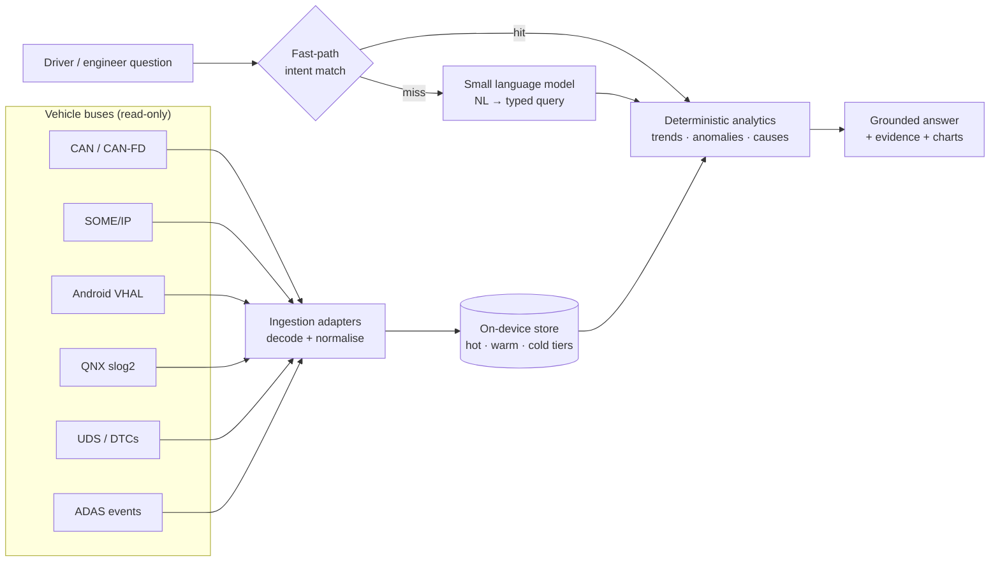

# EdgeCar AI

**Ask your car what happened — offline, on-device, in under two seconds.**

EdgeCar AI is an on-device assistant for software-defined vehicles. It continuously ingests vehicle data —
CAN/CAN-FD, SOME/IP, Android Automotive VHAL, QNX logs, ADAS events and diagnostics — keeps weeks of history
searchable on the vehicle, and answers questions such as:

- *"Why has my driving range dropped over the last two weeks?"*
- *"When did fuel efficiency show the largest drop?"*
- *"Show all ADAS disengagement events from yesterday."*
- *"What happened before the battery overheating warning?"*
- *"Compare energy consumption between city and highway driving."*

It is designed for **~2 GB RAM and two ARM Cortex-A5x cores**, needs **no cloud connection**, and keeps
safety-critical vehicle functions isolated from the AI.

> 🚧 **Status: under active development.** Built for the Tata Elxsi TELIPORT Season 4 challenge
> (Case Study 5). See [`PROGRESS.md`](PROGRESS.md) for the live build log.

## How it works



The language model never computes numbers. It translates the question into a typed, schema-validated query;
a deterministic engine computes every figure from stored data; the answer cites its evidence.
Rationale: [ADR-0001](docs/adr/0001-slm-as-semantic-parser.md).

## Measured, not claimed

All numbers come from scripts in this repository (`edgecar.bench`), with the language model loaded and limited to
**2 CPU threads**:

| | Result |
|---|---|
| Question → query accuracy, **held-out set** (70 questions never used for tuning) | **95.7 %** |
| End-to-end latency over 192 questions | p50 **6.1 ms** · p95 **549 ms** · max 684 ms — **100 % under 2 s** |
| Peak resident memory (assistant + model server) | **1.28 GB** |
| Analytics + privacy redaction | p50 4.3 ms · p95 11 ms |
| Live ingestion: a second of bus traffic becomes queryable in | p50 14 ms · p95 16 ms (67× real time) |
| Fault scenario recovered from wire traffic (QNX, UDS, CAN FD, SOME/IP, VHAL) | **9 / 9** events |
| History on disk (4 vehicles, ~1 year each, encrypted) | ~27 MB |

Most questions never touch the model: a deterministic fast path answers 76 % of them in milliseconds. The rest go to
Qwen2.5-1.5B-Instruct (4-bit, llama.cpp), which writes a 2–6-token command under a grammar; time windows are read by
code, never by the model. It was chosen from six small models on the same task and budget:

| Model (4-bit, 2 threads) | Model-only accuracy (192 q) | Hybrid, held-out (70 q) | p50 / p95 | RSS (private) |
|---|---|---|---|---|
| Qwen2.5-0.5B | 34.4 % | 81.4 % | 223 / 375 ms | 519 MB (167) |
| Qwen3-0.6B | 5.2 % | 75.7 % | 340 / 558 ms | 968 MB (378) |
| Llama-3.2-1B | 35.9 % | 82.9 % | 408 / 602 ms | 992 MB (214) |
| Gemma-3-1B | 39.6 % | 85.7 % | 493 / 679 ms | 980 MB (229) |
| **Qwen2.5-1.5B** | **85.4 %** | **95.7 %** | 510 / 713 ms | 1,158 MB (225) |
| SmolLM2-1.7B | 50.5 % | 84.3 % | 960 / 1,351 ms | 1,534 MB (513) |

See [ADR-0005](docs/adr/0005-hybrid-language-understanding.md). *(Measured on an x86 laptop restricted to 2 threads;
ARM measurements are next.)* Reproduce: `python -m edgecar.bench.models`, `python -m edgecar.bench.e2e`.

## Real data, not just simulation

The demo replays **real vehicle datasets** as genuine protocol traffic — a year of Nissan Leaf driving in
Michigan (VED), summer and winter BMW i3 trips with full battery-thermal channels (TU Munich) — and simulates only
channels with no open real-world source, injecting scenarios with ground truth so accuracy can be measured.

The Leaf data reaches the store **as real CAN frames**: it is encoded with the Leaf's DBC into candump logs
(860 k frames for one car-year), decoded by the ingestion layer, and segmented into trips from bus silence. The
round trip is exact to half a bit on every signal — and the real data even settles an open question in the
community DBC (the heater scale is 250 W/bit, not the guessed 300). See [docs/DATASETS.md](docs/DATASETS.md) and
[ADR-0002](docs/adr/0002-real-data-first.md).

## Repository layout

```
src/edgecar/
  schema.py       canonical signals, units, plausibility ranges, event categories
  fleet.py        the demo vehicles (each a real vehicle from a public dataset)
  protocols/      CAN / CAN FD (DBC), SOME/IP (pcap), Android VHAL, UDS over ISO-TP, QNX slog2
  ingest/         protocol adapters → events; live micro-batch ingestion
  store/          encrypted DuckDB storage: frames, roll-ups, trips, events
  detect.py       event detectors over real signals (charging, hard braking, battery temperature)
  analytics/      deterministic engine: trends, comparisons, change attribution, root-cause timelines
  nlu/            fast-path rules, grammar-constrained SLM parser (llama.cpp), shared pipeline
  query.py        the typed query the language layer produces
  assistant.py    question → query → analytics → answer
  privacy.py      driver / service / fleet redaction policies
  sim/            wire-traffic simulators on real trips (ADAS, fault scenarios)
  prep/           offline dataset conversion and the multi-protocol store build
  bench/          accuracy, latency, memory and model-comparison benchmarks
eval/             labelled question sets (dev + held-out) and benchmark results
docs/             architecture decisions (adr/) and dataset registry
PROGRESS.md       build log, decisions and next steps
```

## Quick start

```bash
python -m venv .venv && .venv/Scripts/pip install -e ".[prep,dev]"   # Linux/macOS: .venv/bin/pip
# fetch the datasets listed in docs/DATASETS.md into data/raw/, then:
python -m edgecar.prep.build --data data --out data/edgecar.duckdb
```

## License

Code: [Apache-2.0](LICENSE). Datasets keep their own licences and are not redistributed — see
[docs/DATASETS.md](docs/DATASETS.md).
