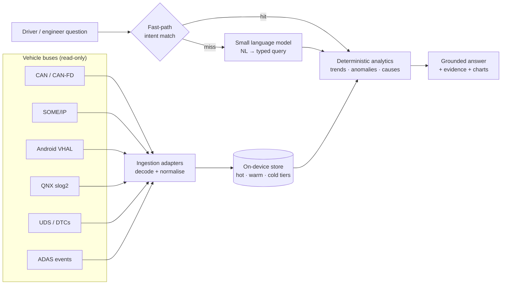

# EdgeCar AI

**Ask your car what happened — offline, on-device, in under two seconds.**

EdgeCar AI is an on-device assistant for software-defined vehicles. It continuously ingests vehicle data —
CAN/CAN-FD, SOME/IP, Android Automotive VHAL, QNX logs, ADAS events and diagnostics — keeps weeks of history
searchable on the vehicle, and answers questions such as:

- *"Why has my driving range dropped over the last two weeks?"*
- *"When did fuel efficiency show the largest drop?"*
- *"Show all ADAS disengagement events from yesterday."*
- *"What happened before the battery overheating warning?"*
- *"Compare energy consumption between city and highway driving."*

It is designed for **~2 GB RAM and two ARM Cortex-A5x cores**, needs **no cloud connection**, and keeps
safety-critical vehicle functions isolated from the AI.

> 🚧 **Status: under active development.** Built for the Tata Elxsi TELIPORT Season 4 challenge
> (Case Study 5). See [`PROGRESS.md`](PROGRESS.md) for the live build log.

## How it works



The language model never computes numbers. It translates the question into a typed, schema-validated query;
a deterministic engine computes every figure from stored data; the answer cites its evidence.
Rationale: [ADR-0001](docs/adr/0001-slm-as-semantic-parser.md).

## Real data, not just simulation

The demo replays **real vehicle datasets** as genuine protocol traffic — a year of Nissan Leaf driving in
Michigan (VED), summer and winter BMW i3 trips with full battery-thermal channels (TU Munich), real Nissan Leaf
CAN encodings — and simulates only channels with no open real-world source, injecting scenarios with ground
truth so accuracy can be measured. See [docs/DATASETS.md](docs/DATASETS.md) and
[ADR-0002](docs/adr/0002-real-data-first.md).

## Repository layout

```
src/edgecar/
  schema.py       canonical signals, units, event categories
  fleet.py        the demo vehicles (each a real vehicle from a public dataset)
  query.py        the typed query the language layer produces
  store/          DuckDB storage: frames, roll-ups, trips, events
  analytics/      deterministic engine: trends, comparisons, change attribution, events
  detect.py       event detectors over real signals (charging, hard braking, battery temperature)
  sim/            simulated channels layered on real trips (ADAS, fault scenarios)
  prep/           offline dataset conversion (VED, TU Munich BMW i3) and store build
docs/             architecture decisions (adr/) and dataset registry
PROGRESS.md       build log, decisions and next steps
```

## Quick start

```bash
python -m venv .venv && .venv/Scripts/pip install -e ".[prep,dev]"   # Linux/macOS: .venv/bin/pip
# fetch the datasets listed in docs/DATASETS.md into data/raw/, then:
python -m edgecar.prep.build --data data --out data/edgecar.duckdb
```

## License

Code: [Apache-2.0](LICENSE). Datasets keep their own licences and are not redistributed — see
[docs/DATASETS.md](docs/DATASETS.md).
