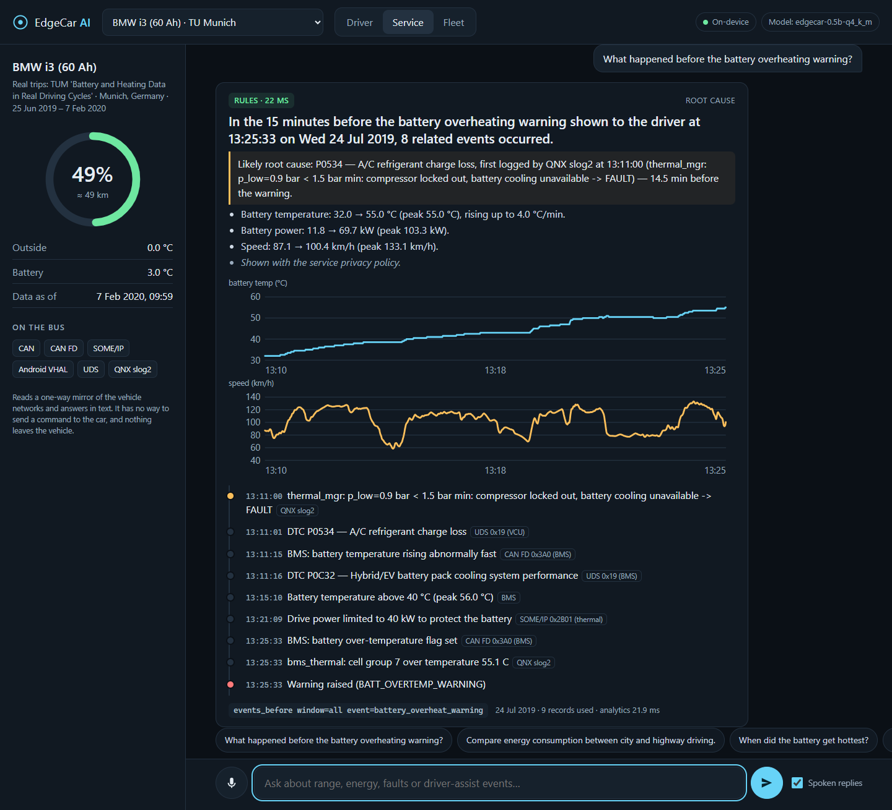
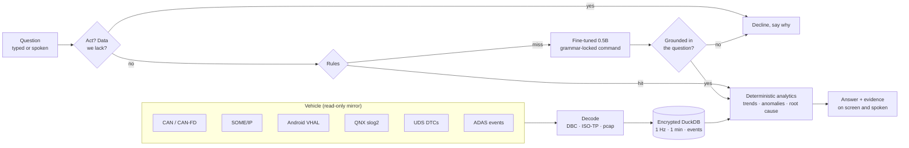
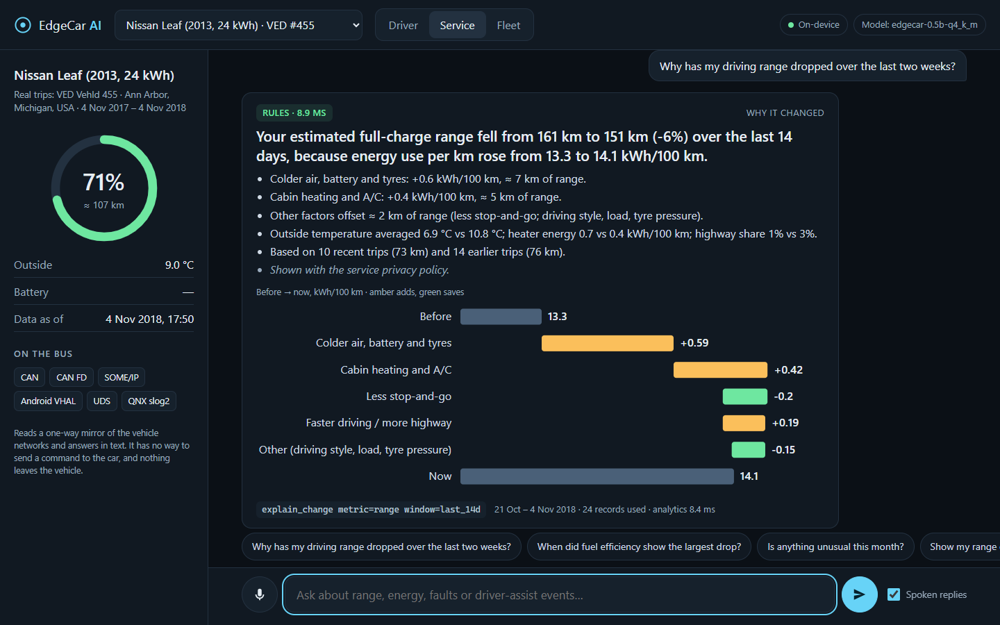
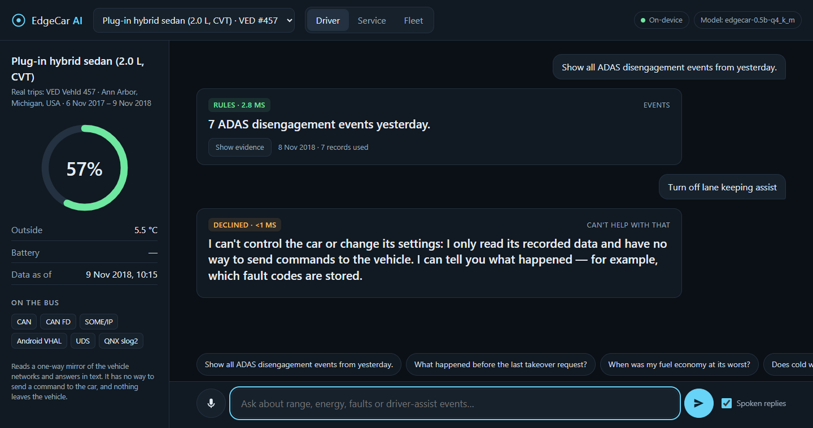

# EdgeCar AI

**Ask your car what happened — offline, on-device, in under two seconds.**

[](https://github.com/meet-png/edgecar-ai/actions/workflows/arm-bench.yml)



*The in-car app on a BMW i3 (real TU Munich trips): asked what happened before the battery overheating warning, it
names the likely root cause — an A/C refrigerant charge loss logged 14.5 minutes earlier — and shows the timeline it
reconstructed from QNX logs, UDS diagnostics, CAN FD and SOME/IP, with the battery temperature behind it. Rules path,
20 ms; nothing leaves the machine.*

EdgeCar AI is an on-device assistant for software-defined vehicles. It ingests vehicle data — CAN/CAN-FD, SOME/IP,
Android Automotive VHAL, QNX logs, ADAS events and UDS diagnostics — keeps a year of history searchable on the vehicle,
and answers questions such as:

- *"Why has my driving range dropped over the last two weeks?"*
- *"When did fuel efficiency show the largest drop?"*
- *"Show all ADAS disengagement events from yesterday."*
- *"What happened before the battery overheating warning?"*
- *"Compare energy consumption between city and highway driving."*

It runs in **2 GB of RAM on two ARM cores**, needs **no cloud connection**, and cannot act on the vehicle: the AI
zone only receives mirrored bus traffic and returns text. Built for the Tata Elxsi TELIPORT Season 4 challenge (Case
Study 5, *Natural Language Vehicle Information using On-Device SLM/LLM*). Build log: [`PROGRESS.md`](PROGRESS.md).

## The idea

| | Typical "LLM over the data" | EdgeCar AI |
|---|---|---|
| Who writes the numbers | The model reads rows and writes figures — they can be invented | A small model writes a 2–6-token, read-only command under a grammar; code computes every figure |
| Common questions | Every question pays for the model | Deterministic rules answer 76 % of questions in milliseconds |
| The model | A general chat model and a long prompt | Our own fine-tuned 0.5B: 398 MB, 36-token prompt, ready in 1 s |
| Memory | Several GB | Runs on a 2 GB AWS Graviton2 machine, OS included (670 MiB in use at peak + the model in page cache) |
| A prompt asking the car to act | Depends on tool access | Impossible: the grammar has no write commands and the zone has no transmit path |



Where it sits in a vehicle (hypervisor partitions, freedom from interference, camera, time sync, security, rollout):
[docs/ARCHITECTURE.md](docs/ARCHITECTURE.md).

## The in-car app

`edgecar serve` runs one page from the AI zone itself — plain HTML, CSS and JavaScript, no build step, no CDN, and a
Content-Security-Policy that lets the browser load nothing from anywhere else ([ADR-0010](docs/adr/0010-in-car-app-and-voice.md)).

- **Push-to-talk, on the device.** Moonshine Tiny (28 MB) recognises a spoken question in 37–49 ms on the laptop; a
  Piper voice trained on public-domain recordings (19 MB) reads the answer back.
- **Every answer shows its evidence**: the route (rules or model) and the time it took, the read-only command that
  ran, and the chart, waterfall, event table or root-cause timeline behind the sentence.
- **One answer, three views.** The driver gets one glanceable, spoken sentence with the evidence a tap away; the
  service engineer and the fleet see everything, after privacy redaction.

| Why the range dropped (service view) | Driver view: events, and a request the assistant declines |
|---|---|
|  |  |

## Our own model

The stock Qwen2.5-1.5B needed a 1,190-token few-shot prompt and, alone, got 82.8 % of the dev questions right. We
fine-tuned Qwen2.5-0.5B and 1.5B with LoRA on 3,795 synthetic questions — 417 written by hand, the rest from
templates — after dropping every one that overlapped an evaluation question, on a 6 GB laptop GPU: 5 minutes for
three epochs of the 0.5B (the first epoch scored best on dev and is the one kept), 14 for the 1.5B
([ADR-0009](docs/adr/0009-fine-tuned-command-model.md), [`src/edgecar/train/`](src/edgecar/train)).

| x86 laptop, 2 threads | Qwen2.5-1.5B few-shot | **edgecar-0.5b** | **edgecar-1.5b** |
|---|---|---|---|
| Held-out (70), rules + model · model alone | 94.3 % · 90.0 % | 92.9 % · 94.3 % | **95.7 % · 97.1 %** |
| Refusal sets (40 + 20) | 39 + 19 | 39 + 19 | **40 + 20** |
| Model path p50 / p95 | 480 / 670 ms | **221 / 299 ms** | 384 / 557 ms |
| llama-server memory · file | 1,157 · 1,117 MB | **499 · 398 MB** | 1,123 · 986 MB |
| Start-up (prompt warm-up) | 13.9 s | **1.0 s** | 1.6 s |

The 0.5B answers 2.2× faster in 2.3× less memory than the model it replaces, within one held-out question of it; the
1.5B is the most accurate model we have measured. In Q8_0 (531 MB) the 0.5B gets one more held-out question right. Both test sets share an author with the training data, so the real test
is [a set written by people outside the project](eval/outside/README.md). ARM numbers for the fine-tuned models are
next; the measurements below are for the few-shot model.

## Measured, not claimed

**On a real 2 GB ARM machine.** AWS EC2 **t4g.small**: 2 Graviton2 cores (Arm Neoverse-N1, the Cortex-A76
generation), **2 GiB of RAM in total, operating system included, no swap**, stock Ubuntu 24.04. The whole AI zone —
live CAN/SOME/IP ingestion at real-time pace, DuckDB, the assistant and llama-server with the few-shot Qwen2.5-1.5B —
ran on it ([results and setup](eval/results/graviton/RUN.md), [`scripts/graviton/run.sh`](scripts/graviton/run.sh)).

| | Result |
|---|---|
| Questions answered in under 2 s | **100 %** of 192 |
| Rules path (146 of 192 questions) | p50 **10 ms** · p95 24 ms |
| Model path (34 questions) | p50 **1.46 s** · p95 1.89 s · max 1.90 s |
| The case study's five example questions | 11–34 ms each, rules path ([brief.json](eval/results/graviton/r1-2026-10-28/brief.json)) |
| Memory, whole machine incl. OS | peak **670 MiB** in use of 1,835 MiB; the model's 1.2 GB stays resident as page cache · 0 OOM |
| Ignition → first answer | 1.1 s (rules) · model ready in **1.5 s** from the saved prompt cache (81 s to compute it) |
| Held-out accuracy · refusal set | 94.3 % · 40/40 (measured before the decline-check fix below) |

**On every push.** GitHub's free Arm64 runner (Neoverse-N2, faster cores) pinned to 2 cores, the whole AI zone in
one cgroup with a hard 1,792 MiB limit ([workflow](.github/workflows/arm-bench.yml),
[results](eval/results/arm/RUN.md)): rules p50 5.8 ms, model path p95 1.36 s, 100 % under 2 s, peak 1.54 GiB
(0.32 GiB anonymous), model ready in 0.8 s, held-out 94.3 % (re-run after the decline-check fix).

**Understanding** (rules + few-shot model, x86 laptop, 2 threads):

| | Result |
|---|---|
| Question → query accuracy, held-out set (70 questions never used to tune rules or prompt) | **94.3 %** |
| Dev set (122 questions the rules were written against) | 100 % |
| Control, injection, out-of-scope and missing-data requests declined (40, frozen set) | **39/40** — 29/40 before the decline checks, which were written after seeing those failures |
| The case study's five example questions | 5/5 on the rules path ([x86](eval/results/brief.json), [Graviton2](eval/results/graviton/r1-2026-10-28/brief.json)) |

Testing the fine-tuned model exposed a bug in the decline checks: every multi-word cue ("battery level") had been
compiled with a literal backslash and never matched. Fixed and re-measured
([ADR-0008](docs/adr/0008-decline-instead-of-guessing.md#correction-2026-10-29), [results](eval/results/rerun)): dev
93.4 → 100 %, held-out 95.7 → 94.3 %, refusals 40/40 → 39/40 — the bug had declined one wrong answer by luck.
(Those before/after figures are x86. The model's output is not bit-identical across CPUs: before the fix, Graviton2
already scored 94.3 %, differing from x86 on one question — "What difference does the outside temperature make to my
consumption?" — answered as a comparison on x86 and as an explanation on ARM.)
The question sets were written by the author with an AI pair-programmer; the held-out set was written after the rules
were frozen, and its first run exposed two vocabulary gaps (fixed generically), so it is no longer blind for those
checks.

**Analytics and data:**

| | Result |
|---|---|
| Root cause named correctly, 200 random fault scenarios with distractors and same-subsystem decoys | **197/200** — vs 34/200 for "earliest fault in the window" |
| Events recovered from wire traffic (QNX, UDS, CAN FD, SOME/IP, VHAL) across those scenarios | 2,409/2,409 |
| One real car-year (52 weeks, 297 trips) on disk, all tiers | **5.5 MB**; 2.2 MB under the retention policy |
| Any typical question over that whole year | 3.5–22 ms median |
| Live ingestion: one second of bus traffic queryable in | p50 14 ms (x86) · 77 ms on Graviton2 while the model is busy |

### Choosing the base model

Six small models on the same task, prompt, grammar and 2-thread budget (x86, few-shot, measured 2026-10-28, before
the decline checks were added):

| Model | Licence | File (4-bit) | Model-only accuracy (192 q) | Hybrid, held-out (70 q) | p50 / p95 | RSS (private) |
|---|---|---|---|---|---|---|
| Qwen2.5-0.5B-Instruct | Apache-2.0 | 491 MB | 34.4 % | 81.4 % | 223 / 375 ms | 519 MB (167) |
| Qwen3-0.6B (Q8_0) | Apache-2.0 | 639 MB | 5.2 % | 75.7 % | 340 / 558 ms | 968 MB (378) |
| Llama-3.2-1B-Instruct | Llama 3.2 Community | 808 MB | 35.9 % | 82.9 % | 408 / 602 ms | 992 MB (214) |
| Gemma-3-1B-it | Gemma Terms of Use | 806 MB | 39.6 % | 85.7 % | 493 / 679 ms | 980 MB (229) |
| **Qwen2.5-1.5B-Instruct** | **Apache-2.0** | 1,117 MB | **85.4 %** | **95.7 %** | 510 / 713 ms | 1,158 MB (225) |
| SmolLM2-1.7B-Instruct | Apache-2.0 | 1,056 MB | 50.5 % | 84.3 % | 960 / 1,351 ms | 1,534 MB (513) |

Few-shot, Qwen2.5-1.5B led by 35 points. Fine-tuned, the 0.5B from the same family answers 97.4 % of the same 192
questions on its own, up from 34.4 % (the later run includes the decline checks). Qwen2.5 is Apache-2.0, so the fine-tuned weights can be too. For bigger tiers, note that Qwen2.5-3B is under a
research-only licence; Qwen3-4B/8B and Qwen2.5-7B are Apache-2.0. See
[ADR-0005](docs/adr/0005-hybrid-language-understanding.md).

## Real data, not just simulation

The demo replays **real vehicle datasets** as genuine protocol traffic — a year of Nissan Leaf driving in Michigan
(VED), summer and winter BMW i3 trips with battery-thermal channels (TU Munich) — and simulates only the channels with
no open real-world source (ADAS state, DTCs, SOME/IP, VHAL, QNX logs), calibrated on real data (BATON's 3,593 ADAS
handovers, TD2D's 500 takeovers) and injected with ground truth so accuracy can be measured.

The Leaf data reaches the store **as real CAN frames** — encoded with the Leaf's community DBC, decoded by the ingestion
layer, segmented into trips from bus silence — exact to half a bit. Along the way the data settled an open question in
the community DBC (the heater scale is 250 W/bit, not the guessed 300) and exposed recordings that kept logging while the
car charged (now excluded from driving energy). See [docs/DATASETS.md](docs/DATASETS.md).

## Try it

```bash
python -m venv .venv && .venv/Scripts/pip install -e ".[prep,dev]"   # Linux/macOS: .venv/bin/pip
python -m edgecar.prep.fetch all          # VED, Leaf DBC, BATON, TD2D tables, the model (SHA-256 pinned)
python -m edgecar.prep.build              # store: real Leaf CAN, PHEV, ADAS over SOME/IP (+ the i3 if downloaded)
edgecar ask "Why has my range dropped over the last two weeks?" --vehicle leaf-455
edgecar brief                             # the case study's example questions, with route and latency
pip install -e ".[voice]" && python -m edgecar.prep.fetch voice      # optional: on-device speech
edgecar serve                             # the in-car app on http://127.0.0.1:8080
```

Fine-tune the command model (a CUDA GPU; separate venv with `pip install -e ".[train]"` and PyTorch for your CUDA):

```bash
python -m edgecar.train.data                                    # synthetic, overlap-checked training set
python -m edgecar.train.finetune --base models/hf/Qwen2.5-0.5B-Instruct --out models/tuned/edgecar-0.5b
python -m edgecar.train.finetune --base models/hf/Qwen2.5-1.5B-Instruct --out models/tuned/edgecar-1.5b \
    --batch 16 --lr 1e-4 --grad-ckpt                            # what fits the 1.5B in 6 GB
python -m edgecar.train.export --merged models/tuned/edgecar-0.5b/merged --name edgecar-0.5b
edgecar serve --model models/edgecar-0.5b-q4_k_m.gguf
```

Each run keeps the epoch with the best dev accuracy and logs what it did in `train_log.json`
([ours](eval/results/train)).

The TU Munich i3 data needs a free IEEE DataPort login ([DATASETS.md](docs/DATASETS.md)); without it the build skips
the i3 and the overheat scenario. llama.cpp's `llama-server` goes in `tools/llama.cpp/` (or on `PATH`); without it,
only the rules path answers.

Reproduce: `pytest` (97 tests) · `python -m edgecar.bench.nlu_eval` · `bench.e2e` · `bench.coldstart` ·
`bench.rootcause` · `bench.storage` · `bench.models`.

## Repository layout

```
src/edgecar/
  protocols/      CAN / CAN FD (DBC), SOME/IP (pcap), Android VHAL, UDS over ISO-TP, QNX slog2
  ingest/         protocol adapters → events; live micro-batch ingestion
  store/          encrypted DuckDB: frames, minute roll-ups, trips, events; retention; erasure
  analytics/      trends, comparisons, anomalies, factor attribution, root-cause timelines
  diagnosis.py    fault-propagation map: event → subsystem, what can overheat which battery
  nlu/            decline checks, rules, grammar-constrained SLM (llama.cpp), shared pipeline
  train/          fine-tuning: overlap-checked synthetic data, LoRA, export to GGUF
  app/            the in-car app (edgecar serve): one page, evidence cards, push-to-talk
  voice.py        on-device speech recognition and synthesis (sherpa-onnx)
  assistant.py    question → query → analytics → answer;  privacy.py: driver / service / fleet roles
  sim/            wire-traffic simulators on real trips: ADAS, fault scenarios with distractors
  prep/           dataset fetch (pinned) and the multi-protocol store build
  bench/          accuracy, latency, memory, cold start, root cause, storage, model comparison
  cli.py          `edgecar ask` / `edgecar brief` / `edgecar serve`
eval/             question sets (dev, held-out, refusal), labelling guide, outside-set protocol, every result
docs/             ARCHITECTURE.md, ADRs, dataset registry, screenshots
.github/          the Arm64 edge benchmark
```

## License

Code: [Apache-2.0](LICENSE). Datasets keep their own licences and are fetched, not redistributed — except the 500-row
TD2D takeover table (CC BY 4.0, attributed in `src/edgecar/sim/calibration/`). See [docs/DATASETS.md](docs/DATASETS.md).
