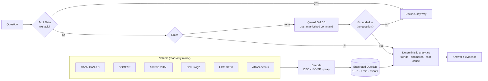

# EdgeCar AI

**Ask your car what happened — offline, on-device, in under two seconds.**

[](https://github.com/meet-png/edgecar-ai/actions/workflows/arm-bench.yml)

EdgeCar AI is an on-device assistant for software-defined vehicles. It ingests vehicle data — CAN/CAN-FD, SOME/IP,
Android Automotive VHAL, QNX logs, ADAS events and UDS diagnostics — keeps a year of history searchable on the vehicle,
and answers questions such as:

- *"Why has my driving range dropped over the last two weeks?"*
- *"When did fuel efficiency show the largest drop?"*
- *"Show all ADAS disengagement events from yesterday."*
- *"What happened before the battery overheating warning?"*
- *"Compare energy consumption between city and highway driving."*

It runs in **2 GB of RAM on two ARM cores**, needs **no cloud connection**, and cannot act on the vehicle: the AI zone
only receives mirrored bus traffic and returns text. Built for the Tata Elxsi TELIPORT Season 4 challenge (Case Study 5,
*Natural Language Vehicle Information using On-Device SLM/LLM*). Build log: [`PROGRESS.md`](PROGRESS.md).

## The idea

| | Typical "LLM over the data" | EdgeCar AI |
|---|---|---|
| Who writes the numbers | The model reads rows and writes figures — they can be invented | A small model writes a 2–6-token, read-only command under a grammar; code computes every figure |
| Common questions | Every question pays for the model | Deterministic rules answer 76 % of questions in milliseconds |
| Memory | Several GB | 1.54 GB peak for the whole AI zone, measured on ARM |
| A prompt asking the car to act | Depends on tool access | Impossible: the grammar has no write commands and the zone has no transmit path |



Where it sits in a vehicle (hypervisor partitions, freedom from interference, camera, time sync, security, rollout):
[docs/ARCHITECTURE.md](docs/ARCHITECTURE.md).

## Measured, not claimed

**On ARM.** Arm Neoverse-N2, pinned to **2 cores**; the whole AI zone — live CAN/SOME/IP ingestion at real-time pace,
DuckDB, the assistant and llama-server — in **one cgroup with a hard 1.75 GB limit and no swap**, on GitHub's free Arm64
runner. Every push re-runs it ([workflow](.github/workflows/arm-bench.yml), results in [eval/results/arm](eval/results/arm)).

| | Result |
|---|---|
| Rules path (146 of 192 questions) | p50 **5.7 ms** · p95 16 ms |
| Model path (34 questions) | p50 **0.92 s** · p95 1.35 s · max 1.35 s |
| Questions answered in under 2 s | **100 %** of 192 |
| Peak memory, whole AI zone | **1.54 GB** of 1.75 GB (0.32 GB anonymous; the rest is the memory-mapped model) · 0 OOM |
| Ignition → first answer | 0.65 s (rules) · model ready in **0.8 s** from the saved prompt cache (57 s to compute it) |

**Understanding** (rules + model, x86 laptop limited to 2 threads unless noted):

| | Result |
|---|---|
| Question → query accuracy, held-out set (70 questions never used to tune rules or prompt) | **95.7 %** (94.3 % on ARM: one borderline answer flips between CPU architectures) |
| Control, injection, out-of-scope and missing-data requests declined (40, frozen set) | **40/40** — 29/40 before the decline checks, which were written after seeing those failures |
| The case study's five example questions | 5/5, rules path, 5–16 ms ([eval/results/brief.json](eval/results/brief.json)) |

The question sets were written by the author with an AI pair-programmer; the held-out set was written after the
rules were frozen and never used to tune them. Its first run with the decline checks scored 92.9 %: it exposed two
vocabulary gaps (inflections such as "driving"; "worried"), fixed generically — so it is no longer blind for those
checks. A fresh set from people outside the project is the next step.

**Analytics and data:**

| | Result |
|---|---|
| Root cause named correctly, 200 random fault scenarios with distractors and same-subsystem decoys | **197/200** — vs 34/200 for "earliest fault in the window" |
| Events recovered from wire traffic (QNX, UDS, CAN FD, SOME/IP, VHAL) across those scenarios | 2,409/2,409 |
| One real car-year (52 weeks, 297 trips) on disk, all tiers | **5.5 MB**; 2.2 MB under the retention policy |
| Any typical question over that whole year | 3.5–22 ms median |
| Live ingestion: one second of bus traffic queryable in | p50 14 ms (x86) · 40 ms on ARM while the model is busy |

### Why Qwen2.5-1.5B

Six small models on the same task, prompt, grammar and 2-thread budget (x86, measured 2026-10-28, before the decline
checks were added):

| Model | Licence | File (4-bit) | Model-only accuracy (192 q) | Hybrid, held-out (70 q) | p50 / p95 | RSS (private) |
|---|---|---|---|---|---|---|
| Qwen2.5-0.5B-Instruct | Apache-2.0 | 491 MB | 34.4 % | 81.4 % | 223 / 375 ms | 519 MB (167) |
| Qwen3-0.6B (Q8_0) | Apache-2.0 | 639 MB | 5.2 % | 75.7 % | 340 / 558 ms | 968 MB (378) |
| Llama-3.2-1B-Instruct | Llama 3.2 Community | 808 MB | 35.9 % | 82.9 % | 408 / 602 ms | 992 MB (214) |
| Gemma-3-1B-it | Gemma Terms of Use | 806 MB | 39.6 % | 85.7 % | 493 / 679 ms | 980 MB (229) |
| **Qwen2.5-1.5B-Instruct** | **Apache-2.0** | 1,117 MB | **85.4 %** | **95.7 %** | 510 / 713 ms | 1,158 MB (225) |
| SmolLM2-1.7B-Instruct | Apache-2.0 | 1,056 MB | 50.5 % | 84.3 % | 960 / 1,351 ms | 1,534 MB (513) |

Qwen2.5-1.5B leads by 35 points at the same private memory as the 1B models (its weights stay a shared memory map). For
bigger tiers, note that Qwen2.5-3B is under a research-only licence; Qwen3-4B/8B and Qwen2.5-7B are Apache-2.0.
See [ADR-0005](docs/adr/0005-hybrid-language-understanding.md).

## Real data, not just simulation

The demo replays **real vehicle datasets** as genuine protocol traffic — a year of Nissan Leaf driving in Michigan
(VED), summer and winter BMW i3 trips with battery-thermal channels (TU Munich) — and simulates only the channels with
no open real-world source (ADAS state, DTCs, SOME/IP, VHAL, QNX logs), calibrated on real data (BATON's 3,593 ADAS
handovers, TD2D's 500 takeovers) and injected with ground truth so accuracy can be measured.

The Leaf data reaches the store **as real CAN frames** — encoded with the Leaf's community DBC, decoded by the ingestion
layer, segmented into trips from bus silence — exact to half a bit. Along the way the data settled an open question in
the community DBC (the heater scale is 250 W/bit, not the guessed 300) and exposed recordings that kept logging while the
car charged (now excluded from driving energy). See [docs/DATASETS.md](docs/DATASETS.md).

## Try it

```bash
python -m venv .venv && .venv/Scripts/pip install -e ".[prep,dev]"   # Linux/macOS: .venv/bin/pip
python -m edgecar.prep.fetch all          # VED, Leaf DBC, BATON, TD2D tables, the model (SHA-256 pinned)
python -m edgecar.prep.build              # store: real Leaf CAN, PHEV, ADAS over SOME/IP (+ the i3 if downloaded)
edgecar ask "Why has my range dropped over the last two weeks?" --vehicle leaf-455
edgecar brief                             # the case study's example questions, with route and latency
```

The TU Munich i3 data needs a free IEEE DataPort login ([DATASETS.md](docs/DATASETS.md)); without it the build skips
the i3 and the overheat scenario. llama.cpp's `llama-server` goes in `tools/llama.cpp/` (or on `PATH`); without it,
only the rules path answers.

Reproduce: `pytest` (82 tests) · `python -m edgecar.bench.nlu_eval` · `bench.e2e` · `bench.coldstart` ·
`bench.rootcause` · `bench.storage` · `bench.models`.

## Repository layout

```
src/edgecar/
  protocols/      CAN / CAN FD (DBC), SOME/IP (pcap), Android VHAL, UDS over ISO-TP, QNX slog2
  ingest/         protocol adapters → events; live micro-batch ingestion
  store/          encrypted DuckDB: frames, minute roll-ups, trips, events; retention; erasure
  analytics/      trends, comparisons, anomalies, factor attribution, root-cause timelines
  diagnosis.py    fault-propagation map: event → subsystem, what can overheat which battery
  nlu/            decline checks, rules, grammar-constrained SLM (llama.cpp), shared pipeline
  assistant.py    question → query → analytics → answer;  privacy.py: driver / service / fleet roles
  sim/            wire-traffic simulators on real trips: ADAS, fault scenarios with distractors
  prep/           dataset fetch (pinned) and the multi-protocol store build
  bench/          accuracy, latency, memory, cold start, root cause, storage, model comparison
  cli.py          `edgecar ask` / `edgecar brief`
eval/             question sets (dev, held-out, refusal) and every benchmark result
docs/             ARCHITECTURE.md, ADRs, dataset registry
.github/          the Arm64 edge benchmark
```

## License

Code: [Apache-2.0](LICENSE). Datasets keep their own licences and are fetched, not redistributed — except the 500-row
TD2D takeover table (CC BY 4.0, attributed in `src/edgecar/sim/calibration/`). See [docs/DATASETS.md](docs/DATASETS.md).
