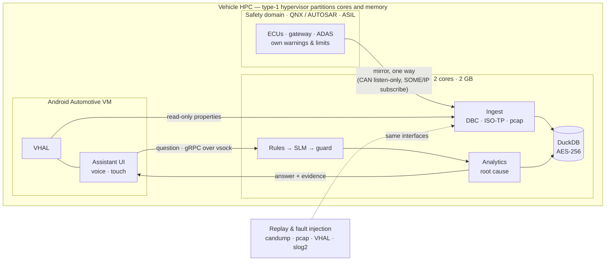

# EdgeCar AI — architecture

How EdgeCar AI would sit in a production vehicle, and what of that this repository implements and measures.
Each section ends with what is **built** here and what is **design** for a vehicle programme.

## 1. Where it runs



| Partition | OS | Why |
|---|---|---|
| Safety domain | QNX / AUTOSAR (existing) | Owns every safety function, warning and limit. EdgeCar only *explains* them. |
| Infotainment | Android Automotive | VHAL is the standard property interface; the driver UI, voice and screens live here. |
| **AI zone** | **Linux guest** | llama.cpp, DuckDB, SocketCAN and vsomeip run natively; cgroups give hard CPU/memory budgets; A/B images for OTA. Inside Android, a 1.3 GB process would compete with the UI and could be killed by the low-memory killer. |

**Freedom from interference (ISO 26262).** The AI zone is QM (no ASIL) and cannot affect the safety domain:

- **spatial** — its own memory partition (hypervisor + SMMU); everything it runs is capped (measured below);
- **temporal** — dedicated cores (two in the measurements), so inference load cannot steal safety-domain time;
- **communication** — one-way data: mirrored bus traffic in, text answers out. The CAN controller is in hardware
  listen-only mode (or the gateway mirrors frames); VHAL access is read-only; there is no transmit path to any bus.

*Built:* the AI zone as processes; its budget measured on Arm64 in a 2-core, 1.75 GB cgroup (section 7).
*Design:* hypervisor partitioning on a vehicle HPC.

## 2. Getting the data

| Source | In a vehicle | In this repository |
|---|---|---|
| CAN / CAN FD | SocketCAN, controller listen-only; DBC/ARXML decoding | Real Leaf data re-encoded with the community Leaf DBC (candump logs); i3 data on CAN FD with a reference DBC |
| SOME/IP | vsomeip subscription to ADAS / thermal services | AUTOSAR header, notifications, Wireshark-readable pcap |
| Android VHAL | Read-only property subscription from the IVI VM | AOSP property IDs, units and enums, JSONL capture |
| Diagnostics (UDS) | **Passive**: the gateway already polls `ReadDTCInformation` (0x19) after fault indications; EdgeCar decodes the request/response pairs. A platform without polling puts a read-only poll list (0x19, 0x22) in the *gateway's* configuration — never in the AI zone | ISO-TP single/multi-frame, SAE J2012 codes |
| QNX logs | slog2 forwarding from the safety domain's logger | `slog2info` text format |
| ADAS | ADAS service events (engaged, takeover request, disengaged + cause) | Simulated on real speed profiles, timed from BATON's 3,593 real handovers |
| Camera | **No raw video in the AI zone.** It ingests what the ADAS stack derives from the cameras — object lists, lane and visibility flags, camera-blocked faults — and references to the clips the ADAS/DVR unit already saves around events, which the IVI can play | "Sensor blocked" and "lane markings lost" disengagements (perception metadata only) |

**Time.** Every source keeps its own timestamp. On automotive Ethernet the clocks are aligned by gPTP (IEEE 802.1AS);
CAN frames are stamped on receipt by the gPTP-disciplined clock; a source without synchronisation (for example a log
forwarder) gets a per-source offset estimated at ingest from a paired event. Everything is stored in UTC.

**Simulation feeds the same interfaces.** Recorded trips are replayed as wire traffic — candump logs to a virtual CAN
interface, pcap replay for SOME/IP, VHAL property injection on an Android Automotive emulator (Cuttlefish), slog2-format
logs — and fault scenarios are injected with ground truth, so accuracy can be measured. Recorded EV data is used for
energy and heat because a driving simulator such as CARLA has no battery or thermal model; CARLA-based TD2D is used only
for human takeover reaction times.

## 3. Storage, retention and search

One encrypted DuckDB file (AES-256-GCM) with three tiers:

| Tier | Kept | One real car-year (Leaf 455, 297 trips, 48 h driving) |
|---|---|---|
| Hot: 1 Hz signals | 8 weeks | 3.9 MB for the year (~80 kB per driving hour) |
| Warm: per-minute roll-ups | 12 months | 0.8 MB |
| Cold: trips and events | life of the vehicle | 0.8 MB |
| **Retained under this policy** | | **2.2 MB** |

Typical questions over the whole year answer in 3.5–22 ms (median, 2 threads; `bench.storage`).

- **Power loss.** Each second of traffic is committed as one transaction to the write-ahead log; a test hard-kills
  a writer mid-ingest and checks every committed batch is there after restart.
- **Flash wear.** Writes are ~80 kB per driving hour, appended in batches; roll-ups and retention run when parked.
- **Search.** Questions become typed queries over signal columns and events, so every number is exact. Log text
  and DTC descriptions are matched by keyword (DuckDB's full-text-search extension for larger logs — R2). There is
  **no vector database**: the answers live in structured telemetry, where similarity search would add an embedding
  model and an index to memory without making any number more exact.

## 4. The AI pipeline

```
question → decline checks → rules (76 %) ─────────────→ typed query → analytics → answer + evidence
                         ↘ SLM: 2–6-token command under a grammar → grounding check ↗
```

1. **Decline checks** (deterministic): requests to *act* ("turn off lane assist", "clear the fault codes") and
   instruction-override attempts are refused; questions about data the car does not have (tyre pressure, video, oil)
   name what is missing.
2. **Rules** answer the common question shapes in milliseconds, with every slot filled.
3. **Qwen2.5-1.5B-Instruct** (4-bit, llama.cpp) handles the long tail. It writes only a verb and a metric or event
   (`why range`, `show dtc`) under a GBNF grammar; time windows are read by code. A command whose metric or event the
   question never mentions is declined instead of guessed.
4. **Analytics** compute every number: trends, comparisons, anomalies (robust z-scores against a physics-informed
   consumption model), factor attribution that adds up, and root cause (section 5).

| | Typical "LLM over the data" | EdgeCar AI |
|---|---|---|
| Who writes the numbers | The model reads rows and writes figures — they can be invented | The model writes a read-only query; code computes every figure |
| Memory | Several GB (large model + long context) | 1.58 GB peak for the whole AI zone, measured |
| Latency | Seconds per answer | Rules p50 6 ms; model path p95 1.35 s on 2 Arm cores |
| Can a prompt make the car act? | Depends on tool access | No: the output grammar contains only read-only commands, and there is no transmit path |

## 5. Root cause

"What happened before the battery overheating warning?" is answered from a **fault-propagation map** in
`edgecar/diagnosis.py`: each event belongs to a subsystem (P0534 → refrigerant circuit, U0155 → network, a `media_svc`
log → infotainment), and the vehicle's cooling architecture decides which subsystems can overheat its battery (the
refrigerant-cooled BMW i3: refrigerant, battery cooling, cells, thermal manager — not the drive electronics' coolant
loop). The likely cause is the most recent such fault before the symptom began (the BMS rise-rate flag), searched back
to the start of the trip.

Measured on 200 random scenarios (`bench.rootcause`, seeds 1000–1199): three fault kinds on real i3 trips, random onset
and severity, 2–6 distractors including same-subsystem decoys — **197/200** correct, against 34/200 for "earliest
fault in the window" and 161/200 for the map without causal ordering. All 2,409 injected events were recovered from the
wire.

## 6. Who uses it, and how

| User | Surface | What they get | Privacy role |
|---|---|---|---|
| Driver | IVI: push-to-talk with on-device speech recognition, or touch | One spoken sentence + an evidence card. While moving: voice only, details locked | `driver`: everything about their own car |
| Service engineer | Workshop laptop on the diagnostic connector, certificate login (UDS 0x29 authentication / mutual TLS) | Full timelines, raw events, export (CSV, candump, pcap) | `service`: no location, no driving-behaviour profile |
| Fleet operator | Back office, synced when parked — only with the owner's opt-in | Anonymised aggregates (energy, faults, ADAS rates) | `fleet`: no location, no per-trip detail |
| Validation team | Workstation running the same code over test-drive and HIL recordings | Plain-language search across logs, auto-built event timelines for defect tickets, comparisons between software builds ("did disengagements rise after build 42?") | `service` |

*Built:* the roles and their redaction (tests in `tests/test_privacy.py`); the CLI. *Design:* the IVI app, voice, laptop tool.

## 7. Edge performance (measured)

Arm Neoverse-N2 (GitHub's Arm64 runner, `.github/workflows/arm-bench.yml`), pinned to **2 cores**, the whole AI zone —
live CAN/SOME/IP ingestion at real-time pace, DuckDB, the assistant and llama-server — in **one cgroup with a hard
1.75 GB limit and no swap** (256 MB of a 2 GB budget left for the guest OS):

| | Result |
|---|---|
| Rules path (146 of 192 questions) | p50 5.7 ms · p95 16 ms |
| Model path (34 questions) | p50 0.92 s · p95 1.35 s · max 1.35 s |
| All 192 questions under 2 s | 100 % |
| Peak memory, whole AI zone | 1,577 MB (330 MB anonymous; the rest is the memory-mapped model, which the kernel can page) · 0 OOM |
| Ignition → first answer | 0.65 s (rules) · model ready in 0.8 s with the saved prompt cache, 57 s without |
| Held-out accuracy on Arm | 94.3 % (one borderline answer flips between CPU architectures; 95.7 % on x86) |

**Slower cores.** The model path is bound by prompt processing (~34 tokens/s on two N2 cores without weight
repacking). A Cortex-A76 (Raspberry Pi 5) is roughly half as fast per core and lacks the i8mm instructions, so the long
tail would likely take 2–3 s or more there (an estimate, not a measurement).
The levers, in order: weight repacking (1.6× faster prompt processing measured, +~0.6 GB), Qwen2.5-0.5B on the
smallest tier (81.4 % hybrid accuracy), an NPU, or a LoRA-tuned smaller model. The common questions are unaffected:
they never touch the model.

## 8. Security and privacy

- **No cloud.** Nothing leaves the vehicle; fleet aggregates only with the owner's opt-in.
- **Keys** in the HSM/TEE (Android Keystore, TrustZone or the SoC's HSM), released to the AI zone at boot — never on
  disk. Destroying the key crypto-shreds every copy of the store.
- **Secure boot** of the hypervisor and the AI-zone image; **signed OTA** (Uptane-style metadata, A/B partitions,
  rollback) for software *and* the model; the model file's SHA-256 is pinned.
- **Read-only by construction.** The model can only emit a command from a fixed grammar of read-only queries; the
  engine opens the store read-only; the zone has no transmit path. Measured: 40/40 control, injection and out-of-scope
  requests declined (29/40 before the decline checks, which were written after seeing those failures).
- **Retention and erasure.** The retention policy above; `Store.wipe` erases a vehicle's data from every tier on the
  driver's request (India's DPDP Act 2023, GDPR Art. 17).

## 9. Taking it to a new vehicle

Configuration, not retraining: the vehicle's DBC/ARXML maps to the signal catalogue; its VHAL properties, DTC
catalogue and cooling architecture fill the fault-propagation map; metric definitions stay the same. The rules and the
prompt are vehicle-agnostic; the evaluation sets are re-run per vehicle; the result ships as a signed OTA update.

## 10. Scaling

| Tier | Example hardware | Model | Status |
|---|---|---|---|
| Entry | 2 Arm cores, 2 GB (Graviton t4g.small, Pi 5 pinned to 2 cores) | Qwen2.5-1.5B Q4_K_M, CPU | Measured on Neoverse-N2 (section 7) |
| Entry + NPU | Raspberry Pi 5 + AI HAT+ 2 (Hailo-10H, 8 GB on the HAT; Qwen2.5-1.5B-Instruct is in its model list) | Same model on the NPU — frees the host's RAM; independent tests found the Pi's CPU as fast for most LLMs, and the runtime must accept the output grammar (or the command is validated and retried) | Design |
| Vehicle HPC | Automotive SoC with an NPU, several GB for the AI zone | 3–8B for multi-step questions: Qwen3-4B/8B or Qwen2.5-7B (Apache-2.0). Not Qwen2.5-3B: its licence is research-only | Design |

Six models were compared on the same task and budget (README): Qwen2.5-1.5B leads model-only accuracy (85.4 % vs
≤ 50.5 %); Qwen2.5-0.5B reaches 81.4 % hybrid, enough for an entry tier where memory matters more than the long tail.
